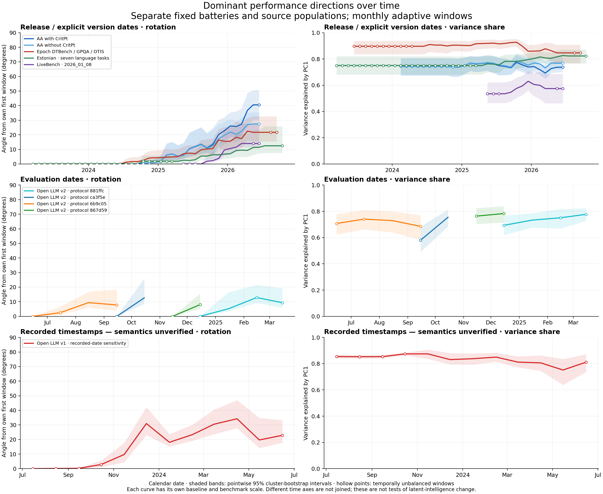

# Public gAI benchmark studies

Standalone analyses of public LLM benchmarks: retrospective release cohorts, dominant performance directions, PCA rotation null tests, and exploratory factor/measurement-invariance analyses. No company-internal benchmark inputs or access are required.

## Findings

- [PCA direction comparisons](output/aa-pca/FINDINGS.md): the first-to-last release-cohort rotation is 30.8° including CritPt and 21.3° excluding it.
- [Shared-axis null calibration](output/aa-pca-null/FINDINGS.md): rotations exceed sampling variation under the tested conditional nulls.
- [CFA loading invariance](output/aa-invariance/README.md) and [residual CFA](output/aa-residual-cfa/README.md): relative fit improvements do not establish adequate absolute fit or changes in latent intelligence.
- [Acquired dataset coverage](output/downloaded-data-audit/README.md), [AA provenance](output/downloaded-data-audit/AA-SUITABILITY.md), [Epoch coverage](output/epoch-audit/README.md), and [shared Epoch batteries](output/epoch-cohorts/README.md).
- Earlier [LiveBench factor analysis](output/public-gai/README.md), [modern exports](output/modern-gai/README.md), and [dataset search](feasibility/dataset-search/README.md).

The main AA analysis compares 2025 H1, 2025 H2 and 2026 H1 model releases using a frozen July 2026 score snapshot. These are retrospective release cohorts, not historical snapshots of scores available at those dates. PCA direction changes concern covariance geometry, not proof of changing latent intelligence.

## Setup and quick start

Python 3.12+ and [uv](https://docs.astral.sh/uv/) are required for the commands below. Alternatively install the four dependencies in pyproject.toml and use `python` instead of `uv run`.

```bash
uv sync
uv run python -m unittest discover -s tests -v
OPENBLAS_NUM_THREADS=1 uv run python aa_cohort_pca.py --resamples 2000
uv run python aa_pca_plot.py
OPENBLAS_NUM_THREADS=1 uv run python aa_pca_null.py --resamples 2000
uv run python aa_pca_null_plot.py
```

The saved `output/aa-cohort/matrix.csv` and `configurations.csv` are public aggregate inputs for these commands and the CFA extensions. No raw download is required for this starting point. Each bootstrap run overwrites that analysis's saved outputs; copy them first if preserving the original run matters. A 2,000-draw null run is substantially slower than the tests.

## Inputs and reproduction

All existing public downloads have been moved here locally. Multi-GB raw downloads, caches and acquisition/run logs are ignored by Git; they are not part of a fresh clone. Compact analysis results, numeric arrays, reports, manifests and public aggregate inputs remain trackable. No data or scientific result was recomputed during migration.

- **AA source regeneration:** `aa_cohort_factor.py --resamples 1000 --seed 20261026` reads `public-data/archives/aa-bundle.zip`. This produces the cohort inputs used downstream. The frozen original ZIP SHA-256 is recorded in `output/aa-cohort/metadata.json`. The acquisition script downloads current upstream main and cannot guarantee the original July snapshot survives there; retain the existing ZIP separately for exact source-level replay.
- **CFA:** after cohort inputs exist, run `aa_residual_cfa.py`, then `aa_invariance_study.py`, then `aa_invariance_report.py`; plotting commands and exact resampling options are in [REPRODUCE.md](REPRODUCE.md).
- **Epoch:** put the downloaded Epoch benchmark export at `benchmark_data.zip`, then run `epoch_data_audit.py` and `epoch_cohort_overlap.py`.
- **Other public datasets:** run `bash download_public_datasets.sh` with internet access. It records HF revisions and hashes; individual failures are reported. Historical acquisition status is in the audit reports, rather than the earlier acquisition notes.
- **Historical LiveBench:** the local content-addressed cache plus `feasibility/livebench/manifest.json` pins the original inputs. `livebench_feasibility.py --offline` requires those ignored cache files. `--refresh` acquires a new snapshot and can change results; it is not exact replay.

See [REPRODUCE.md](REPRODUCE.md) for all existing study commands, [DATA_SOURCES.md](DATA_SOURCES.md) for provenance and redistribution notes, and [MIGRATION.json](MIGRATION.json) for the extraction inventory. Archived hashes and logs describe original runs; they are not claims that those runs used the new repository layout.

The numerical helper `factor_models.py` is a local copy shared historically with the internal study; this repo has no dependency on that study or its repository.


## Parallel rolling PCA

[Findings and figures](output/parallel-rolling-pca/FINDINGS.md) compare separate AA, Epoch, Estonian and LiveBench release-date trajectories. Open LLM evaluation and unverified recorded timestamps appear on separate panels. Fixed benchmark panels are selected before nearest-50-base windows; the full run uses 2,000 matched cluster bootstrap draws per source.



```bash
OPENBLAS_NUM_THREADS=1 OMP_NUM_THREADS=1 uv run python parallel_rolling_pca.py --resamples 2000
uv run python plot_parallel_rolling_pca.py
```

Original raw inputs must be available locally to regenerate source panels. Exported matrices, memberships, scaling, bootstrap arrays and plots are included. Use `--out` to preserve the saved run. The early calendar range has coarse temporal resolution because adaptive windows borrow neighboring releases. Pointwise angle intervals are not a calibrated test of rotation or latent-intelligence change.
