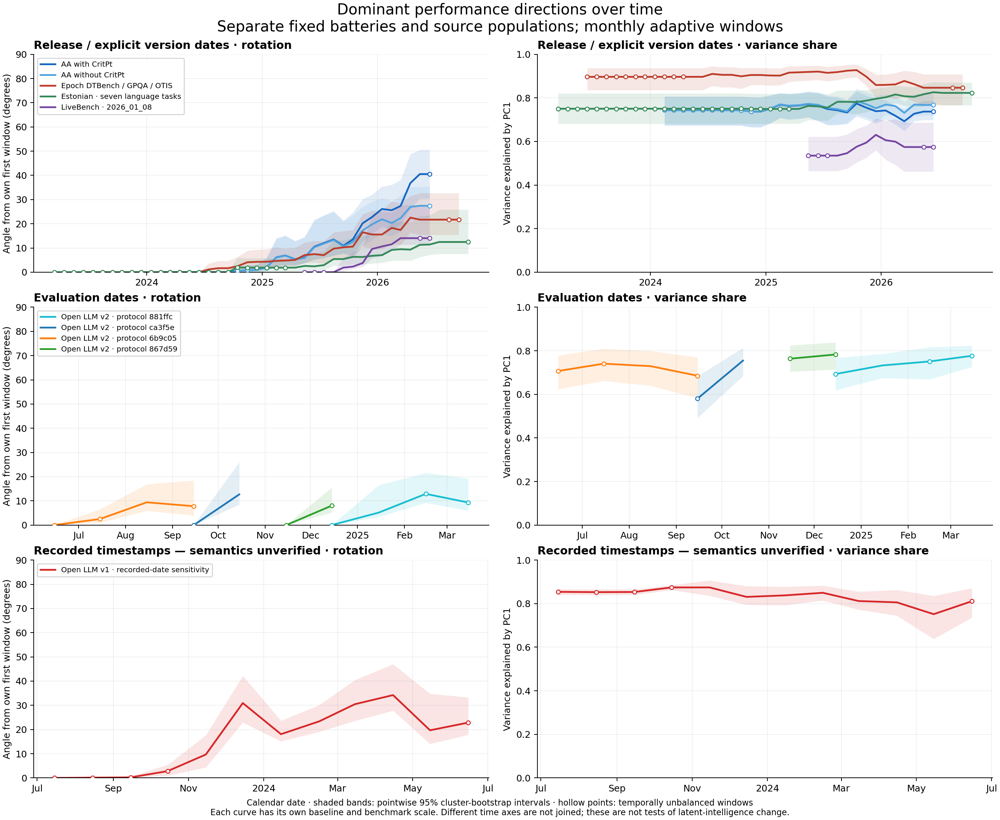

# Rolling PCA findings

The corrected analysis produces separate source trajectories, including Epoch. The earlier missing Epoch curve was caused by forming windows before selecting complete fixed-battery configurations.

## Release-date series

| Series | Calendar grid | Complete dated configurations | Named bases/groups | First-to-last rotation | Pointwise 95% bootstrap interval |
|---|---|---:|---:|---:|---|
| AA with CritPt | 2024-02–2026-06 | 409 | 301 | 40.5° | 30.4–50.6° |
| AA without CritPt | 2024-02–2026-06 | 409 | 301 | 27.4° | 22.5–35.3° |
| Epoch DTBench / GPQA / OTIS | 2023-06–2026-09 | 122 | 112 | 21.7° | 15.4–32.7° |
| Epoch Chess / GPQA / OTIS | 2024-02–2026-10 | 133 | 74 | 17.1° | 8.1–27.7° |
| Estonian · seven language tasks | 2023-03–2026-10 | 88 | 88 | 12.5° | 7.6–25.9° |
| LiveBench · 2026_01_08 | 2025-05–2026-06 | 91 | 91 | 14.1° | 11.4–27.7° |

These ranges describe rotation from different initial windows on different batteries. They are not directly comparable effect sizes or evidence of an identical latent construct. Early monthly estimates often reuse the same 50 bases and borrow heavily from later releases. The apparent 2023 start does not imply independently measured monthly covariance in 2023.
AA changes little under the one-configuration-per-base sensitivity: first-to-last angles are 40.7° with CritPt and 27.7° without. Epoch DTBench/GPQA/OTIS is similarly close (21.3° selected versus 21.7° all configurations). Epoch Chess/GPQA/OTIS is more configuration-sensitive (29.2° selected versus 17.1° all configurations).

## Other time axes and static replications

Four separate Open LLM v2 protocol groups cover June 2024 through March 2025 evaluation months. Each uses the same six task metrics but its own protocol, scaling and first-window baseline; curves are not spliced into a common series. Open LLM v1 is shown separately for July 2023–June 2024 using its recorded timestamps, whose semantics remain unverified. All v1 rows are flagged in that source snapshot, so this is explicitly a sensitivity analysis.
ObsScaling base/instruction and WILD are static replications because fewer than 20 complete models have unambiguous dates in the available local metadata. WILD means remain provisional because duplicate item-key conflicts were not resolved. Training-step datasets remain outside calendar-time plots.

## Validation

All 49 tracked-public and new rolling-analysis tests pass. Direct PCA recomputation from exported matrices and memberships reproduces all 344 window estimates. All 2,000 cluster draws are admissible at every estimated window, including paired comparisons with the first window. Figures were rendered and visually inspected.
Bootstrap bands are pointwise and conditional on the observed model population, named-base clustering, fixed scaling and fixed window memberships. Overlapping windows are dependent. Positive angle intervals do not test the shared-axis null; no new calibrated rotation test is claimed here.

## Reproduction

See [methods and commands](README.md), [window estimates](windows.csv), [source panels](series.csv), [configuration sensitivities](sensitivities.png) and [benchmark coefficients](loadings.png). No missing scores are imputed, batteries stay fixed, and source scores are not pooled.
