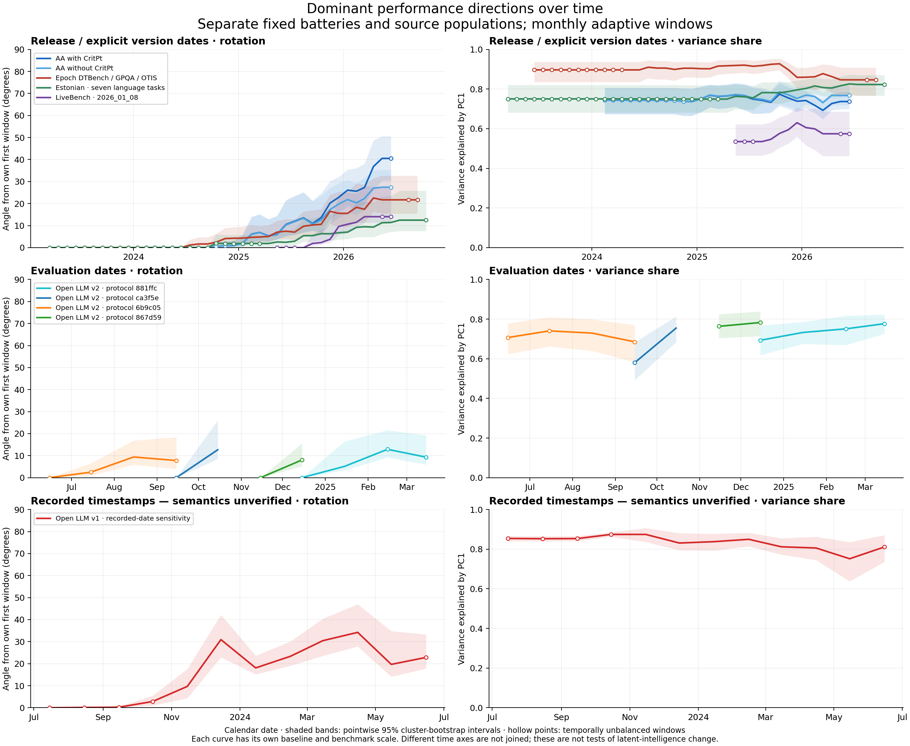

# Parallel rolling PCA

Separate fixed-battery trajectories, using all locally supportable dates. Complete eligible configurations are selected before time windows.



[Source loadings](loadings.png) · [Configuration and battery sensitivities](sensitivities.png)

| Series | Time axis | Complete configurations | Dated bases | Result | Range |
|---|---|---:|---:|---|---|
| AA with CritPt | release | 409 | 301 | ok | 2024-02-15 – 2026-06-15 |
| AA nine · one configuration/base | release | 409 | 301 | ok | 2024-02-15 – 2026-06-15 |
| AA without CritPt | release | 409 | 301 | ok | 2024-02-15 – 2026-06-15 |
| AA eight · one configuration/base | release | 409 | 301 | ok | 2024-02-15 – 2026-06-15 |
| Epoch DTBench / GPQA / OTIS | release | 122 | 112 | ok | 2023-06-15 – 2026-09-15 |
| Epoch broad · one configuration/group | release | 122 | 112 | ok | 2023-06-15 – 2026-09-15 |
| Epoch Chess / GPQA / OTIS | release | 133 | 74 | ok | 2024-02-15 – 2026-10-15 |
| Epoch chess · one configuration/group | release | 133 | 74 | ok | 2024-02-15 – 2026-10-15 |
| Estonian · seven language tasks | release | 90 | 88 | ok | 2023-03-15 – 2026-10-15 |
| Open LLM v2 · protocol 881ffc | evaluation | 2464 | 2307 | ok | 2024-12-15 – 2025-03-15 |
| Open LLM v2 · protocol ca3f5e | evaluation | 622 | 564 | ok | 2024-09-15 – 2024-10-15 |
| Open LLM v2 · protocol 6b9c05 | evaluation | 538 | 517 | ok | 2024-06-15 – 2024-09-15 |
| Open LLM v2 · protocol 867d59 | evaluation | 245 | 232 | ok | 2024-11-15 – 2024-12-15 |
| Open LLM v1 · recorded-date sensitivity | recorded | 7170 | 6789 | ok | 2023-07-15 – 2024-06-15 |
| LiveBench · 2026_01_08 | release | 126 | 91 | ok | 2025-05-15 – 2026-06-15 |
| ObsScaling base | release | 124 | 0 | static only; fewer than 20 dated bases |  –  |
| ObsScaling instruct | release | 22 | 9 | static only; fewer than 20 dated bases |  –  |
| WILD · provisional aggregate replication | release | 65 | 8 | static only; fewer than 20 dated bases |  –  |

## Interpretation

Rotation is relative to each series’s own first window, in fixed within-source benchmark units. Curves have different batteries, populations and baselines; their angles and variance shares are descriptive cross-checks, not a shared intelligence scale. A three-task Epoch battery is much narrower than AA. PCA rotation does not identify a change in latent intelligence.
2,000 whole-base cluster draws per source produce pointwise 95% percentile intervals. Adjacent windows overlap. Positive angle intervals are not a test of a shared-axis null; rotation has a sampling-noise floor. More than 10% inadmissibility withholds an interval. Base IDs do not establish independent ancestry.
Monthly plotting does not create monthly information: early/late windows borrow across releases. Hollow markers indicate less than 20% of window bases on one side of the grid date; window spans, effective dates and unique membership counts are exported. Whole-panel series with 20–49 dated bases contain no within-series temporal resolution.
Release/version-date panels, evaluation-date panels and unclassified recorded-timestamp panels are separate. Dates resolved by exact alias do not establish equal configurations or protocols. No cross-source scores are pooled and no missing scores are filled.
Source loaders and frozen model matrices are included. Old integration-audit candidates are not used as verified model bridges. Bootstrap output arrays and code/input hashes accompany the CSVs. Figures replace the earlier invalid coverage plot, which mixed window-radius days with configuration counts.

## Source notes

- **AA with CritPt**: All complete archived configurations; no half-year date cutoff.
- **AA nine · one configuration/base**: Highest explicit effort, then model slug; no score-based choice.
- **AA without CritPt**: All complete archived configurations; no half-year date cutoff.
- **AA eight · one configuration/base**: Highest explicit effort, then model slug; no score-based choice.
- **Epoch DTBench / GPQA / OTIS**: Fixed audited battery; conflicting cells/dates excluded; exact configurations, known model groups; mixed evaluation sources/settings remain. Group date is earliest eligible configuration release.
- **Epoch broad · one configuration/group**: Fixed audited battery; conflicting cells/dates excluded; exact configurations, known model groups; mixed evaluation sources/settings remain. Group date is earliest eligible configuration release. Prefer high label then lexical configuration ID.
- **Epoch Chess / GPQA / OTIS**: Fixed audited battery; conflicting cells/dates excluded; exact configurations, known model groups; mixed evaluation sources/settings remain. Group date is earliest eligible configuration release.
- **Epoch chess · one configuration/group**: Fixed audited battery; conflicting cells/dates excluded; exact configurations, known model groups; mixed evaluation sources/settings remain. Group date is earliest eligible configuration release. Prefer high label then lexical configuration ID.
- **Estonian · seven language tasks**: Source release dates; model IDs treated as bases; broader ancestry unresolved. Fixed seven-task battery.
- **Open LLM v2 · protocol 881ffc**: Stored protocol signature 881ffc66ed0d13f94385e02f5928c38abd4be197a6e32dc5518e31a79009fee0. Largest group first; additional >=50-model groups chosen by run count only when they extend calendar-month coverage. Each protocol has its own scale/baseline and is not spliced. Earliest complete run per model/revision/precision; base cluster is repository name. Fixed six aggregate metrics; IFEval prompt-level strict accuracy. Protocol signature is a consistency screen, not proof of identical chat templates.
- **Open LLM v2 · protocol ca3f5e**: Stored protocol signature ca3f5e88c694c680ec203dc72ceeb03bc94dde234f0af8d578fcf834245ca2f6. Largest group first; additional >=50-model groups chosen by run count only when they extend calendar-month coverage. Each protocol has its own scale/baseline and is not spliced. Earliest complete run per model/revision/precision; base cluster is repository name. Fixed six aggregate metrics; IFEval prompt-level strict accuracy. Protocol signature is a consistency screen, not proof of identical chat templates.
- **Open LLM v2 · protocol 6b9c05**: Stored protocol signature 6b9c05f116ce26b1c8a5e9b5c717f0350f7a3e3b60d04b4deaa8f0e2518c9551. Largest group first; additional >=50-model groups chosen by run count only when they extend calendar-month coverage. Each protocol has its own scale/baseline and is not spliced. Earliest complete run per model/revision/precision; base cluster is repository name. Fixed six aggregate metrics; IFEval prompt-level strict accuracy. Protocol signature is a consistency screen, not proof of identical chat templates.
- **Open LLM v2 · protocol 867d59**: Stored protocol signature 867d59b75bc252bb8fb71c77e892ac915c0410ce6ab04ef472e0736629c43686. Largest group first; additional >=50-model groups chosen by run count only when they extend calendar-month coverage. Each protocol has its own scale/baseline and is not spliced. Earliest complete run per model/revision/precision; base cluster is repository name. Fixed six aggregate metrics; IFEval prompt-level strict accuracy. Protocol signature is a consistency screen, not proof of identical chat templates.
- **Open LLM v1 · recorded-date sensitivity**: Contents date semantics are unverified; not treated as release/evaluation time. All rows flagged=True with unresolved semantics; protocol variation and selection bias remain. Exploratory separate-axis sensitivity.
- **LiveBench · 2026_01_08**: Fixed edition chosen by largest complete dated count only. Explicit model version dates and unambiguous exact aliases; release/version dates may differ. Base groups use explicit organization/displayName/version date when available; broader ancestry unresolved. No edition-date cohort assignment; no stripped effort-name aliases.
- **ObsScaling base**: No source release-date column. Dates only from unambiguous exact aliases; do not infer release dates from FLOPs/training size.
- **ObsScaling instruct**: No source release-date column. Dates only from unambiguous exact aliases; do not infer release dates from FLOPs/training size.
- **WILD · provisional aggregate replication**: Task means include unresolved repeated/conflicting item keys. Aggregate replication is provisional; no item-bootstrap or definitive directional claim.

## Reproduce

```sh
OPENBLAS_NUM_THREADS=1 uv run python parallel_rolling_pca.py --resamples 2000
uv run python plot_parallel_rolling_pca.py
```

Raw inputs must be present locally; large downloads remain Git-ignored. Use `--out` for a separate run. `matrix.csv` exports the final source panels for inspection.
